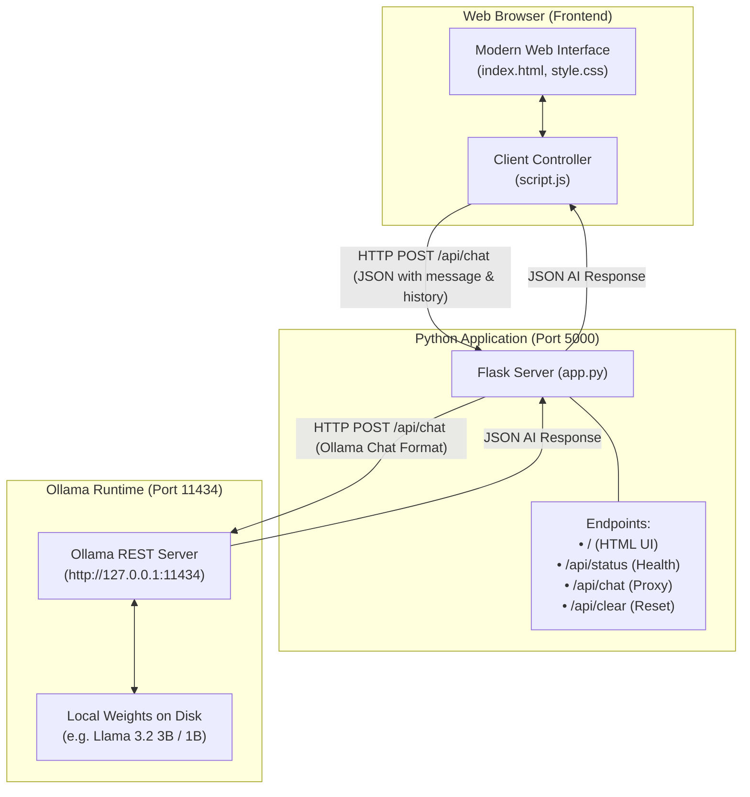

# 🤖 Local Open-Source LLM Chatbot

> A 100% private, self-hosted AI chatbot running directly on your Windows PC using **Ollama**, **Llama 3.2**, **Python Flask**, and vanilla HTML/CSS/JavaScript. No cloud APIs, no subscription fees, and no data leaving your machine.

---

## 📑 Table of Contents
1. [Project Overview](#-1-project-overview)
2. [Architecture Diagram](#-2-architecture-diagram)
3. [Prerequisites](#-3-prerequisites)
4. [Folder Structure](#-4-folder-structure)
5. [Step-by-Step Installation Guide](#-5-step-by-step-installation-guide)
6. [Running the Application](#-6-running-the-application)
7. [Testing Procedure & Test Cases](#-7-testing-procedure--test-cases)
8. [Troubleshooting Guide](#-8-troubleshooting-guide)
9. [Security and Privacy](#-9-security-and-privacy)
10. [Future Enhancements](#-10-future-enhancements)

---

## 🌟 1. Project Overview

Cloud-based AI models (such as ChatGPT, Claude, and Gemini) send every prompt, document, and piece of code to remote servers over the internet.

This **Local Open-Source LLM Chatbot** runs large language models (such as Meta's **Llama 3.2**) entirely on your local hardware:
- **Zero API Costs:** Run unlimited queries without paying for tokens.
- **Complete Privacy:** Prompts and responses never leave `127.0.0.1` (localhost).
- **Works Offline:** Once the model is downloaded, no active internet connection is required.
- **Customizable:** Swap models freely (e.g., Llama 3.2 1B/3B, Mistral, Gemma 2, Phi-3).

---

## 🏛️ 2. Architecture Diagram

The system operates across three local tiers communicating through local loopback connections:



---

## 📋 3. Prerequisites

Before installing the application, ensure your Windows machine meets these requirements:

| Component | Minimum Requirement | Recommended |
| :--- | :--- | :--- |
| **Operating System** | Windows 10 (64-bit) or Windows 11 | Windows 11 |
| **Python** | Python 3.10 or higher | Python 3.11 / 3.12 / 3.14 |
| **System RAM** | 8 GB RAM (for 1B model) | 16 GB+ RAM (for 3B model) |
| **GPU (Optional)** | Intel/AMD Integrated CPU | NVIDIA RTX GPU with CUDA (faster inference) |
| **Disk Space** | ~5 GB free space for model weights | SSD with 10 GB+ free |

---

## 📁 4. Folder Structure

```text
LocalLLMChatbot/
│
├── app.py                # Flask server, Ollama API proxy, input validation & error handling
├── requirements.txt      # Python dependencies (Flask, requests)
├── README.md             # Complete beginner documentation, setup & troubleshooting guide
│
├── templates/
│   └── index.html        # Modern HTML5 responsive chat interface
│
└── static/
    ├── style.css         # Dark glassmorphic design system with animations & responsive CSS
    └── script.js         # Client-side chat loop, Ollama status monitor, markdown & code copy
```

### Purpose of Each File:
- **`app.py`**: The heart of the backend. It serves the web UI and receives chat prompts from the browser. It formats conversations into Ollama's chat schema (`[{"role": "user", "content": "..."}, ...]`), forwards them to the local Ollama API (`http://127.0.0.1:11434/api/chat`), and returns the response safely.
- **`requirements.txt`**: Specifies minimal, reliable Python packages (`Flask` and `requests`).
- **`templates/index.html`**: The user interface structure featuring a live status pill, dynamic model dropdown, message container, quick suggestion cards, and input controls.
- **`static/style.css`**: Professional modern dark theme with smooth gradients, glassmorphism, responsive mobile layout, custom scrollbar, and animated typing waves.
- **`static/script.js`**: Manages state, handles user interaction, checks if Ollama is online, parses markdown, formats code snippets with copy buttons, and sends AJAX requests.

---

## ⚙️ 5. Step-by-Step Installation Guide

Follow these exact steps in **Windows Command Prompt (`cmd.exe`)** or **PowerShell**:

### Step 1: Verify Python Installation
Open Command Prompt and run:
```cmd
python --version
```
> If Python is not installed, download it from [python.org](https://www.python.org/downloads/) (ensure you check **"Add python.exe to PATH"** during installation).

### Step 2: Install Ollama on Windows
1. Download the official Windows installer from [ollama.com/download/windows](https://ollama.com/download/windows).
2. Run `OllamaSetup.exe` and follow the standard installer prompts.
3. Once installed, Ollama runs in your Windows System Tray (near the system clock).
4. Verify by opening a new Command Prompt and running:
```cmd
ollama --version
```

### Step 3: Download the AI Model
Download Meta's lightweight Llama 3.2 model:
```cmd
ollama run llama3.2
```
*Note for computers with 8GB RAM:* If you want an even lighter model that uses under 1.5 GB of RAM, you can use:
```cmd
ollama run llama3.2:1b
```
*(You can test asking a quick question in the terminal, then press `Ctrl + D` or type `/bye` to exit the terminal chat. Ollama will keep running in the background).*

### Step 4: Open the Project Directory
Navigate to your project directory:
```cmd
cd "c:\Users\vadiv\OneDrive\Documents\html\reactapp\hackathon\opensourcellm"
```

### Step 5: Create a Python Virtual Environment
Creating a virtual environment ensures project dependencies do not interfere with other Python software on your system:
```cmd
python -m venv venv
```

Activate the virtual environment:
- **In Command Prompt (`cmd.exe`):**
  ```cmd
  venv\Scripts\activate
  ```
- **In PowerShell:**
  ```powershell
  .\venv\Scripts\Activate.ps1
  ```
*(Your prompt will now show `(venv)` at the beginning).*

### Step 6: Install Project Dependencies
Run pip to install Flask and Requests:
```cmd
pip install -r requirements.txt
```

---

## 🚀 6. Running the Application

### 1. Ensure Ollama is Running
Make sure the Ollama application is active in your system tray, or run in a terminal:
```cmd
ollama serve
```

### 2. Start the Flask Server
In your activated virtual environment terminal, run:
```cmd
python app.py
```

You will see output similar to:
```text
=================================================================
🚀 Starting Local Open-Source LLM Chatbot
📡 Target Ollama Service : http://127.0.0.1:11434
🤖 Configured Default Model: llama3.2
🔒 Privacy Notice         : 100% Localhost Only (No external APIs)
🌐 Web Application URL   : http://127.0.0.1:5000
=================================================================
Press CTRL+C in this terminal window to stop the server.

 * Serving Flask app 'app'
 * Running on http://127.0.0.1:5000
```

### 3. Open in Your Browser
Open your preferred browser (Chrome, Edge, Firefox, Brave) and navigate to:
```text
http://127.0.0.1:5000
```

---

## 🧪 7. Testing Procedure & Test Cases

Follow these test cases to verify that your local chatbot is working properly:

| Test # | Test Scenario | Steps to Execute | Expected Result |
| :---: | :--- | :--- | :--- |
| **1** | **Basic Question & Answer** | Type `"What is Python?"` and press <kbd>Enter</kbd> or click the Send arrow. | Loading indicator ("Thinking...") appears, followed by a well-formatted AI response explaining Python. |
| **2** | **Multi-Turn Conversation** | Follow up with `"Can you show me a simple example of a loop in it?"` without repeating the word Python. | The model remembers previous context and provides a Python `for` or `while` loop with syntax-highlighted code block and a "Copy" button. |
| **3** | **Empty Input Validation** | Attempt to click Send or press <kbd>Enter</kbd> when the input box is empty or filled with only spaces. | Send button remains disabled; no network request is sent; the system rejects empty messages. |
| **4** | **Ollama Not Running** | Close Ollama (right-click Ollama tray icon -> Quit) and refresh the page. | Status indicator shows a red dot and `"Ollama Offline"`. An informative warning banner appears with instructions to start Ollama. |
| **5** | **Model Not Downloaded** | Type an uninstalled model name (e.g. `nonexistent-model`) into the model field or select it. | An error message appears stating that the model was not found, with instructions to run `ollama run <model>` in terminal. |
| **6** | **Long Question / Code Generation** | Paste a multi-paragraph prompt or ask: `"Write a complete Python program with a class for a Bank Account that handles deposits, withdrawals, and balance checks."` | The model processes the long context and returns code formatted inside a dedicated code box with working copy button. |
| **7** | **Clearing Conversation** | Click the `"Clear"` button at the top right, then confirm. | Messages disappear, welcome screen returns, and conversation history is reset to 0. |

---

## 🛠️ 8. Troubleshooting Guide

### 1. `ollama : The term 'ollama' is not recognized`
- **Cause:** Ollama was installed, but the Command Prompt window was open before installation, or Ollama's path was not refreshed.
- **Solution:** Close all open Command Prompt / VS Code windows and reopen a new terminal. If still not found, check that `C:\Users\<YourUsername>\AppData\Local\Programs\Ollama` is in your Windows System PATH.

### 2. `Address already in use` or Port 5000 Conflict
- **Cause:** Another process or AirPlay / previous Flask instance is using port 5000.
- **Solution:** In `app.py`, change `port=5000` to `port=5050` or run:
  ```cmd
  python -c "from app import app; app.run(port=5050)"
  ```

### 3. Ollama Responding Very Slowly
- **Cause:** Large models running on CPU only.
- **Solution:** Switch to a smaller model optimized for low-resource computers:
  ```cmd
  ollama run llama3.2:1b
  ```
  In the web UI, select `llama3.2:1b` from the model dropdown.

### 4. PowerShell Script Execution Policy Error (`Activate.ps1 cannot be loaded`)
- **Cause:** Windows PowerShell restricts script execution by default.
- **Solution:** Run this command once in PowerShell:
  ```powershell
  Set-ExecutionPolicy -ExecutionPolicy RemoteSigned -Scope CurrentUser
  ```
  Or simply use standard Command Prompt (`cmd.exe`).

---

## 🔒 9. Security and Privacy

1. **Localhost Binding:** `app.py` binds strictly to `127.0.0.1` (localhost). It is not accessible from other computers on your local network or the internet.
2. **Zero Telemetry:** The application does not contain analytics, trackers, or external third-party script tags.
3. **Important Privacy Distinction:** Running locally means your chat data is not sent to external cloud providers. However, local files and memory can still be accessed by any other software running on your computer with user permissions. Keep your operating system updated.

---

## 🚀 10. Future Enhancements

Once you are comfortable with this foundation, here is how you can expand the project:

1. **Local RAG (Retrieval-Augmented Generation) for PDFs:**
   - Use `langchain` or `chromadb` to embed PDF files locally using `nomic-embed-text` via Ollama (`ollama pull nomic-embed-text`), enabling you to ask questions about private local documents.
2. **Streaming Responses:**
   - Enable `stream: True` in the Ollama API call and use Flask's `Response(stream_with_context(...), mimetype='text/event-stream')` to stream tokens character-by-character (like ChatGPT).
3. **Chat Exporting:**
   - Add an "Export Chat" button in `script.js` to download the active conversation as Markdown (`.md`) or JSON.
4. **Persistent Conversation Storage (SQLite):**
   - Store conversations in a local `chatbot.db` SQLite database so previous chats can be restored across browser sessions.
5. **Modern Single-Page App (React / Vite / Next.js):**
   - Replace the vanilla frontend with a Next.js or React frontend with component libraries like Tailwind CSS or Shadcn UI.
